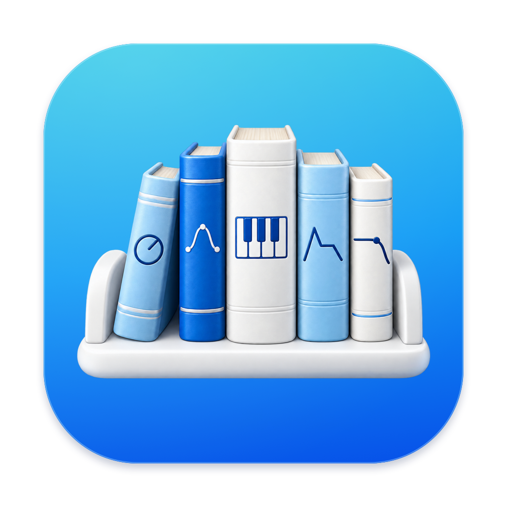
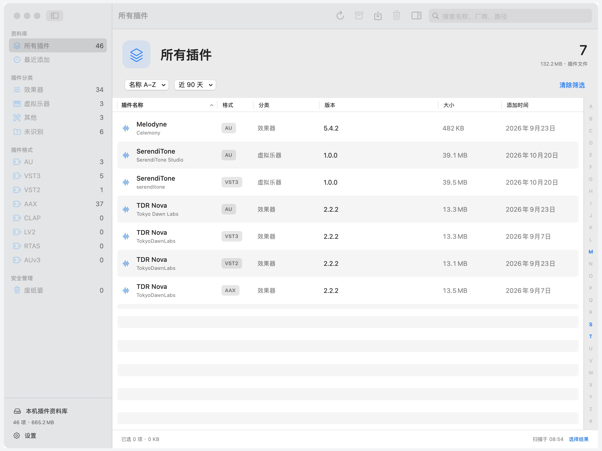

# PluginShelf · 插件架

原生 macOS 音频插件管理工具。快速找到插件，批量备份、恢复和整理，让插件资料库保持清楚、有序。

[下载 1.1（构建 18）](https://github.com/xincheng1237/PluginShelf/releases/latest) · [English](README.en.md) · [更新日志](CHANGELOG.md) · [反馈问题](https://github.com/xincheng1237/PluginShelf/issues)

## 能做什么

- **查找插件**：扫描 AU、VST2、VST3、AAX、CLAP、LV2、RTAS 等格式，支持搜索、时间筛选、排序和首字母定位。
- **批量备份与恢复**：导出带校验清单的备份包，将插件恢复到原安装位置。
- **整理废纸篓**：删除前核对清单并完成两步确认，删除后可在应用内查看记录、批量还原或永久删除。
- **使用熟悉的 macOS 界面**：原生窗口、工具栏与多选操作，支持简体中文、英文和跟随系统语言。
- **检查更新**：启动时低频检查，在发现新版时轻提示；也可从应用菜单或设置中手动检查。

## 安装

需要 **macOS 14 或更新版本**。同一个 Universal 2 安装包支持 **Apple 芯片与 Intel**。

1. 从 [Releases](https://github.com/xincheng1237/PluginShelf/releases/latest) 下载 DMG。
2. 打开镜像，将 PluginShelf 拖入“应用程序”。升级前请先退出旧版。
3. 从“应用程序”打开 PluginShelf，扫描本机插件。

当前发行包采用 ad-hoc 签名，尚未 Apple 公证。[安装说明](docs/INSTALL_README.txt)提供首次打开与升级说明。

已安装旧构建的 1.1 用户，请从发行页手动下载并替换。旧更新器只比较版本号，不会提示同版本的更高构建。

## 备份与删除须知

备份包含插件文件，不包含独立音色库、许可证或厂商安装器。恢复不会覆盖已有同名文件。

删除的插件进入系统废纸篓。自动清理取决于 Finder 中的“30 天后移除废纸篓中的项目”设置；清空废纸篓会提前彻底删除。PluginShelf 不安装后台清理程序或登录项。

AUv3 应用内扩展仅供查看。受权限保护的目录可能无法直接写入；自动分类尚不能识别所有插件，可以手动调整。完整说明见[使用指南](docs/USER_GUIDE.md)。

## 开发与反馈

使用 SwiftUI、AppKit 和 Swift 6 构建，无第三方运行依赖。源代码构建、测试与发布流程见[开发指南](CONTRIBUTING.md)，功能验证范围见[验证记录](docs/VERIFICATION.md)。

欢迎通过 [Issues](https://github.com/xincheng1237/PluginShelf/issues) 反馈问题或建议；提交截图、日志前请遮盖私人路径和授权信息。

源码已公开，目前未提供开源许可证。
